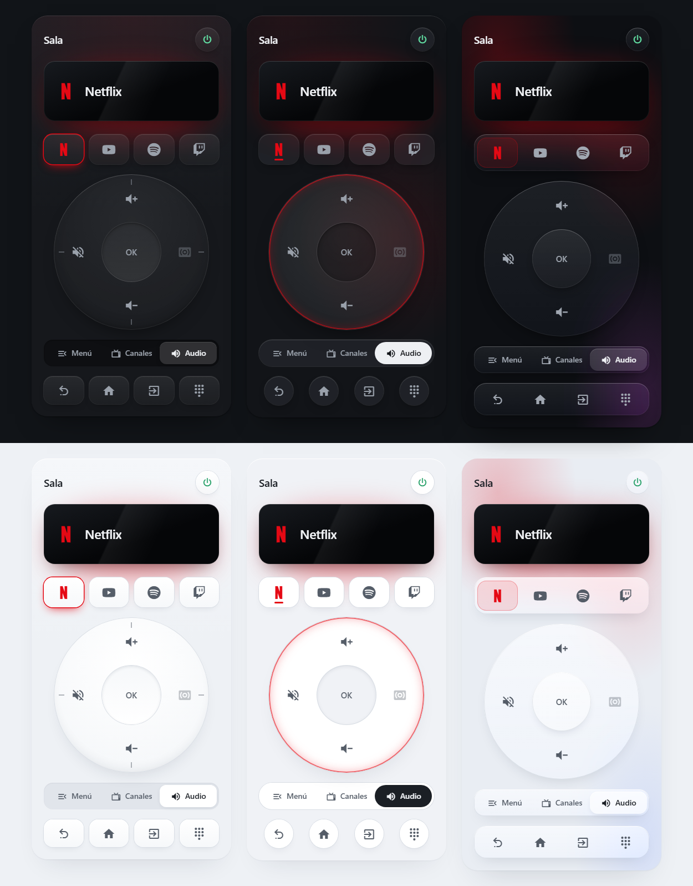
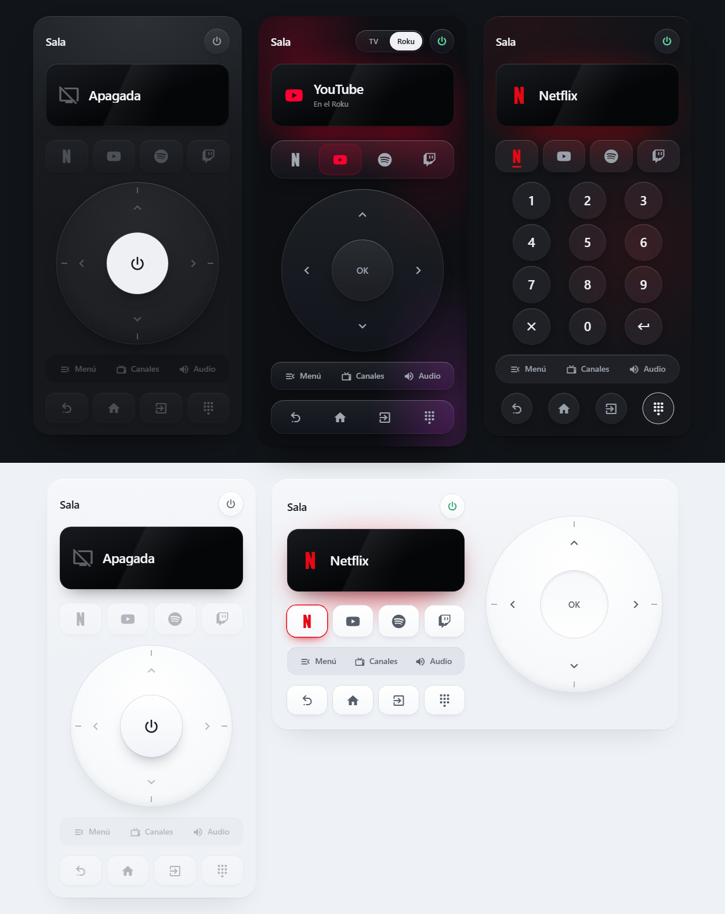

# TV Control Card

🌐 [Versión en español](README.md)

Home Assistant card for controlling **LG (webOS)** and **Samsung** TVs, with
optional support for a **Roku** connected to the TV. Multiple TVs in a single card,
three visual styles, light or dark theme, and a visual editor.

[](CHANGELOG.md)
[](https://github.com/custom-components/hacs)



---

## Features

- **Three styles**: `relieve` (default), `halo` and `cristal`, in `dark`, `light`
  or `auto` theme (follows Home Assistant's dark mode).
- **Status screen** showing the active app or source, tinted with the brand color.
- **Touchpad** with modes: Menú (Menu), Canales (Channels), Audio, and up to 3 custom modes.
- **4 streaming buttons**: if the TV is off, they turn it on and open the app.
- **Multiple TVs** in one card, with the selected TV remembered per user.
- **Roku connected to the TV**: TV | Roku switch, plus apps that only exist on the Roku.
- **Per-TV configuration**: different modes, buttons or streaming for a specific TV.
- **Any action on any button**: key, source, script, service, LG command, raw code,
  sequence (e.g. a PIN), a different action per brand, or the numeric keypad.
- **Safe**: holding down an arrow never locks up the TV, and the card never turns
  off a TV because of a stale state.
- **Responsive**: adapts to the card's actual width, from a phone to a wall-mounted
  tablet (where it switches to two columns).



---

## Requirements

- Home Assistant with a Lovelace dashboard.
- Depending on the brand:
  - **LG**: official [LG webOS TV](https://www.home-assistant.io/integrations/webostv/) integration.
    Turning the TV on requires configuring power-on (Wake on LAN) in the integration.
  - **Samsung**: [SamsungTV Smart](https://github.com/ollo69/ha-samsungtv-smart) integration (HACS).
  - **Roku** (optional): official [Roku](https://www.home-assistant.io/integrations/roku/) integration,
    which creates a `media_player` and a `remote`.
- [Custom Brand Icons](https://github.com/elax46/custom-brand-icons) for the `phu:`
  icons (Disney+, Prime Video, Apple TV, Max, Roku…).
- A browser or app that supports container queries and `color-mix()`:
  Chrome/Edge 111+, Safari/iOS 16.4+, or an up-to-date Home Assistant app.

---

## Installation

### With HACS (recommended)

1. HACS → three-dot menu → **Custom repositories**.
2. Add `https://github.com/extraiotpruebas/minimalist-tv-control-card` with the
   category **Dashboard**.
3. Search for **TV Control Card** and install it.
4. Reload the browser (Ctrl + F5).

### Manual

1. Copy `dist/minimalist-tv-control-card.js` (from this repository) to `/config/www/`.
2. **Settings → Dashboards → ⋮ → Resources → Add resource**:
   - URL: `/local/minimalist-tv-control-card.js?v=1`
   - Type: **JavaScript module**
3. Every time you replace the file, bump the `?v=` number so browsers and the app
   don't keep using the old copy.

### Trying v4 alongside the version you already have installed

Two versions can't register the same card name. With `?tag=`, v4 registers under a
different name and both can coexist:

1. Copy the new file under a different name, e.g. `/config/www/tv-card-v4.js`.
2. Add the resource `/local/tv-card-v4.js?tag=tv-control-card-v4&v=1` (JavaScript module).
3. In the test card use `type: custom:tv-control-card-v4`.

Existing cards (`custom:tv-control-card`) keep using the installed version.

---

## Configuration

The easiest way is the **visual editor** (Edit card). It shows only what is
configured; everything else appears as **+ Agregar…** (+ Add…) or **Personalizar**
(Customize). If the card has YAML from an earlier version, the editor offers a
**Convertir a formato v4** (Convert to v4 format) button.

### Minimal

```yaml
type: custom:tv-control-card
tvs:
  - name: Sala
    entity: media_player.tv_sala
    platform: lg            # lg | samsung
```

### Full (example)

```yaml
type: custom:tv-control-card
card_id: sala               # remembers the selected TV per user (unique per card)
style: halo                 # relieve | halo | cristal
theme: auto                 # dark | light | auto
control_mode_entity: input_select.modo_tv   # optional

tvs:
  - name: Sala
    entity: media_player.tv_sala
    platform: lg
    companion:                              # Roku connected to this TV (optional)
      media_entity: media_player.roku_sala
      remote_entity: remote.roku_sala
  - name: Recámara
    entity: media_player.tv_recamara
    platform: samsung
    overrides:                              # this TV's own configuration (optional)
      modes: [audio, menu, busqueda]
      buttons:                              # replaces the entire global `buttons`
        menu: { icon: mdi:dialpad, action: numpad }
        top_left: { icon: mdi:palette, action: script.modo_arte }

modes: [menu, busqueda, custom1]            # the 3 modes in the row

custom_modes:
  custom1:
    label: Amplificador
    icon: mdi:speaker
    up:    { icon: mdi:volume-plus,  action: script.ampli_subir }
    down:  { icon: mdi:volume-minus, action: script.ampli_bajar }
    left:  { icon: mdi:volume-off,   action: mute }
    right: { icon: mdi:power,        action: script.ampli_power }

streaming:                                  # the 4 buttons, in order
  - source: netflix
  - source: disney
  - source: YouTube
  - source: hdmi2
    icon: mdi:sony-playstation
    accent: '#0070d1'

buttons:
  menu: { icon: mdi:dialpad, action: numpad }   # the Menu button opens the numeric keypad
```

---

## Reference

### General options

| Option | Default | Description |
|---|---|---|
| `tvs` | — (**required**) | List of TVs. See below. |
| `card_id` | derived from the entities | Identifies the card so it can remember each user's selected TV. Use it if you have several cards with the same TVs. |
| `style` | `relieve` | `relieve`, `halo` or `cristal`. |
| `theme` | `dark` | `dark`, `light` or `auto`. |
| `control_mode_entity` | — | `input_select` that sets the active mode. Its options must be mode ids (`menu`, `audio`, `custom1`…); any other value leaves the touchpad with no mode. |
| `modes` | `[menu, busqueda, audio]` | The 3 modes in the row. |
| `custom_modes` | — | Definition of `custom1`, `custom2`, `custom3`. |
| `default_pad` | arrows | The touchpad when no mode is active. |
| `streaming` | Netflix, Disney+, YouTube, Apple TV | The 4 streaming buttons. |
| `buttons` | — | Changes the icon or action of the fixed buttons. |
| `palette` | — | Color palette for the card. See [Palettes](#palettes). |
| `palettes` | — | Your own palettes. |

### `tvs`

| Option | Description |
|---|---|
| `name` | Display name. |
| `entity` | The TV's `media_player` (**required**). |
| `platform` | `lg` or `samsung` (default `lg`). |
| `companion` | Connected Roku: `media_entity` (`media_player`) and `remote_entity` (`remote`). |
| `overrides` | This TV's own configuration. Accepts `modes`, `custom_modes`, `default_pad`, `streaming` and `buttons`. Each category you set **fully replaces** the global one (it is not merged field by field). |

With two or more TVs, tapping the TV name opens the selector.

### Modes

Tapping a mode activates it; tapping it again returns to the touchpad with no mode (`default_pad`).

| Id | Name | ↑ | ← | → | ↓ |
|---|---|---|---|---|---|
| `menu` | Menú | Home | Menu | Exit | Back |
| `busqueda` | Canales | Channel + | Input menu | Guide | Channel − |
| `audio` | Audio | Volume + | Mute | — | Volume − |
| `fuentes` | Fuentes (Inputs) | HDMI 1 | HDMI 2 | HDMI 3 | HDMI 4 |
| `info` | Información (Info) | Guide | Info | Recent apps ¹ | Quick settings ¹ |
| `custom1`…`custom3` | Custom | defined in `custom_modes` |

¹ On LG. On Samsung those two buttons are My apps and Tools.

`navegacion` (from earlier versions) is converted to `menu`. In the `audio`,
`fuentes` and `info` modes everything goes to the TV even when Roku mode is active.

The `fuentes` mode switches inputs **by port** (`input` action, see
[Actions](#actions)), so it works even if the input has another name on the TV. For
other inputs or icons (e.g. "PlayStation" on HDMI 2), use a custom mode with `input:`
actions.

### `custom_modes` and `default_pad`

```yaml
custom_modes:
  custom2:
    label: PIN
    icon: mdi:lock
    up:    { icon: mdi:lock-open, action: [digit_1, digit_2, digit_3, digit_4, enter] }
    left:  { icon: mdi:television-guide, action: guide }
    right: info                     # shorthand: action only (no icon)
    down:  { icon: mdi:cast }       # no action: the button stays empty

default_pad:
  up: { icon: mdi:chevron-up, action: up }
```

Each direction (`up`, `left`, `right`, `down`) takes `icon` and `action`.

### `streaming`

There are always 4 buttons. Each one:

| Field | Description |
|---|---|
| `source` | Catalog id (table below). |
| `icon` | Changes the icon. |
| `accent` | Color of the active button and the screen (`'#e50914'` or `'229, 9, 20'`). |
| `action` | Custom action instead of opening the source. |

On tap: if the TV is off it turns it on; then it opens the source and waits for
confirmation (retrying once). With a Roku in Roku mode, or if the app only exists on
the Roku (e.g. Fubo), it opens it on the Roku.

<details>
<summary>Source catalog</summary>

| `source` | Name | Icon | On the TV (`select_source`) | On the Roku |
|---|---|---|---|---|
| `netflix` | Netflix | `mdi:netflix` | `Netflix` | `Netflix` |
| `disney` | Disney+ | `phu:disney-plus` | `Disney+` | `Disney Plus` |
| `prime` | Prime Video | `phu:prime-video` | `Prime Video` | `Prime Video` |
| `YouTube` | YouTube | `mdi:youtube` | `YouTube` | `YouTube` |
| `appletv` | Apple TV | `phu:apple-tv` | `Apple TV` | `Apple TV` |
| `hbomax` | Max | `phu:hbo-max` | `Max` | `Max` |
| `paramount` | Paramount+ | `phu:paramount-plus` | `Paramount+` | `Paramount Plus` |
| `dazn` | DAZN | `phu:dazn` | `DAZN` | `DAZN Live Sports Streaming` |
| `universal` | Universal+ | `mdi:earth` | `Universal+` | `Universal+` |
| `spotify` | Spotify | `mdi:spotify` | `Spotify` | `Spotify` |
| `crunchyroll` | Crunchyroll | `mdi:alpha-c-circle` | `Crunchyroll` | `Crunchyroll` |
| `twitch` | Twitch | `mdi:twitch` | `Twitch` | `Twitch` |
| `fubo` | Fubo | `mdi:alpha-f-circle` | Roku only | `Fubo: Watch Live TV & Sports` |
| `roku` | Roku | `phu:roku-ultra` | `Roku OTT` or `Roku` | — |
| `hdmi1` … `hdmi4` | HDMI 1 … 4 | `mdi:hdmi-port` | by port (`input` action) | — |

The name is matched case-insensitively against the list of sources the TV reports
(`source_list`). HDMI buttons don't use the name: they switch by port, without waiting
for confirmation (HA reports the input's name, which doesn't say which port it is).

</details>

### `buttons`

| Button | Default | Notes |
|---|---|---|
| `top_left` | hidden | Header button, on the left. Only appears if you assign it a custom action (e.g. a script). With a Roku, its place is taken by the TV \| Roku switch. |
| `power` | turn on / off | With a custom action, that action replaces both turning on and turning off. |
| `center` | `enter` (OK) | With the TV off, the center becomes the **Encender** (Power on) button (it only turns on, never off). |
| `back` | `back` | Bottom row. |
| `home` | `home` | Bottom row. |
| `exit` | `exit` | Bottom row. |
| `menu` | `menu` | Bottom row. |

Each button accepts `icon` and `action`. Shorthand: `power: script.x` is equivalent to
`power: { action: script.x }`.

**With the TV off** the touchpad, the modes and the bottom row are locked.
The center (Encender), power, the streaming buttons and `top_left` remain active.

### Palettes

A palette recolors the whole card: it is **5 colors and a base** (light or dark); every
other shade (surfaces, borders, secondary text…) is derived from them, so it is hard to
end up with an unreadable combination. Every color is optional: anything you leave out
comes from the style (`relieve`, `halo`, `cristal`) in the chosen base.

| Color | What it paints |
|---|---|
| `background` | The card background. |
| `button` | Apps, keys, touchpad and modes. |
| `text` | Text and icons. |
| `accent` | The interface color when no app is active. |
| `on` | The "powered on" indicator. |

**8 palettes are built in** (no need to define them): `grafito`, `medianoche`, `ciruela`,
`bosque`, `oled` (dark) and `nube`, `arena`, `menta` (light). All of them meet 4.5:1
contrast for text over the background and over the buttons.

```yaml
palette: medianoche                 # one for the whole card
# or a different one per theme:
palette: { light: nube, dark: grafito }

palettes:                           # your own (one with the same name replaces the built-in)
  sala:
    base: dark                      # dark | light
    background: '#1b1d21'           # also: 'rrggbb', '#abc' or '26, 29, 33'
    button: '#2c2f35'
    text: '#eceef1'
    accent: '#f0b44c'
    on: '#62d6a0'
```

They can be assigned in four places; **the most specific wins**:

1. `streaming[i].palette`: while that button (the app) is active.
2. `companion.palette`: in Roku mode (set inside the TV's `companion`).
3. `overrides.palette` of a TV.
4. The card's `palette`.

A name that does not exist is skipped (the next level is used) and the card warns in the
console with the list of built-in palettes. The palette's base decides whether the card
looks light or dark, overriding `theme`. An app's accent (Netflix red) is applied on top of
the palette.

The visual editor has a **Palettes** panel to create, copy, rename and pick the colors of
palettes, with swatches and contrast shown.

### Actions

Any `action` can be written like this:

```yaml
action: vol_up                      # key (table below); also VOLUMEUP or KEY_VOLUP
action: script.mi_script            # script or scene
action: numpad                      # opens the numeric keypad
action: [digit_1, digit_2, enter]   # sequence (400 ms pause)

action: { type: key, key: input_menu }
action: { type: button, button: KEY_HDMI }            # brand's raw code
action: input:hdmi2                                   # input by port (see below)
action: { type: source, source: PlayStation }         # select_source by exact name
action: { type: service, service: light.toggle, data: { entity_id: light.sala } }
action:                                               # LG command (webostv.command)
  type: command
  command: system.launcher/launch
  payload: { id: netflix }
action:                                               # sequence with its own pause
  type: sequence
  delay: 600
  steps: [home, down, down, enter]
action:                                               # one action per brand
  type: platform
  by:
    lg: input:hdmi1
    samsung: input:hdmi3
    default: input_menu
```

**Inputs by port (`input`)**: `hdmi1` … `hdmi4` and `tv` (antenna / cable). They don't
depend on the input's name on the TV:

| `input` | LG (`webostv.command`) | Samsung (`play_media` `send_key`) |
|---|---|---|
| `hdmi1` … `hdmi4` | `tv/switchInput` `{ inputId: HDMI_1 }` | `ST_HDMI1` |
| `tv` | `system.launcher/launch` `{ id: com.webos.app.livetv }` | `ST_TV` |

With a connected Roku, inputs always go to the TV. The Roku has no inputs.


- **Holding down** repeats only the arrows (every 250 ms, for up to 10 s). Everything
  else is sent once per tap.
- **With a Roku in Roku mode**, only the keys the Roku has (except volume and mute)
  and `platform` actions with a `roku` variant go to the Roku. Everything else goes to
  the TV: EXIT always works.
- **Useful LG commands**: `system.launcher/launch` (`{id}`), `tv/switchInput`
  (`{inputId: HDMI_1}`), `com.webos.service.tvpower/power/turnOffScreen` (turns off
  only the screen), `system.notifications/createToast` (`{message}`),
  `com.webos.service.ime/insertText` (`{text, replace: 0}`), `media.controls/play`.
  App and input ids are listed under **Devices → (the TV) → Download
  diagnostics**.

<details>
<summary>Key table</summary>

| Key | What it does | LG | Samsung | Roku |
|---|---|---|---|---|
| `up` | Up | `UP` | `KEY_UP` | `up` |
| `down` | Down | `DOWN` | `KEY_DOWN` | `down` |
| `left` | Left | `LEFT` | `KEY_LEFT` | `left` |
| `right` | Right | `RIGHT` | `KEY_RIGHT` | `right` |
| `enter` | Enter / OK | `ENTER` | `KEY_ENTER` | `select` |
| `back` | Back | `BACK` | `KEY_RETURN` | `back` |
| `exit` | Exit | `EXIT` | `KEY_EXIT` | — |
| `home` | Home | `HOME` | `KEY_HOME` | `home` |
| `menu` | Menu | `MENU` | `KEY_MENU` | — |
| `info` | Info | `INFO` | `KEY_INFO` | `info` |
| `guide` | Guide | `GUIDE` | `KEY_GUIDE` | — |
| `apps` | My apps | `MYAPPS` | `KEY_APP_LIST` | — |
| `recent` | Recent apps | `RECENT` | — | — |
| `search` | Search | — | — | `search` |
| `input_menu` | Input menu | `INPUT_HUB` | `KEY_SOURCE` | — |
| `ch_up` | Channel up | `CHANNELUP` | `KEY_CHUP` | `channel_up` |
| `ch_down` | Channel down | `CHANNELDOWN` | `KEY_CHDOWN` | `channel_down` |
| `ch_prev` | Previous channel | — | `KEY_PRECH` | — |
| `vol_up` | Volume up | `VOLUMEUP` | `KEY_VOLUP` | `volume_up` |
| `vol_down` | Volume down | `VOLUMEDOWN` | `KEY_VOLDOWN` | `volume_down` |
| `mute` | Mute | `MUTE` | `KEY_MUTE` | `volume_mute` |
| `play` | Play | `PLAY` | `KEY_PLAY` | `play` |
| `pause` | Pause | `PAUSE` | `KEY_PAUSE` | `play` |
| `stop` | Stop | `STOP` | `KEY_STOP` | — |
| `rewind` | Rewind | `REWIND` | `KEY_REWIND` | `reverse` |
| `ff` | Fast forward | `FASTFORWARD` | `KEY_FF` | `forward` |
| `replay` | Replay | — | — | `replay` |
| `record` | Record | `RECORD` | `KEY_REC` | — |
| `cc` | Subtitles | `CC` | `KEY_CAPTION` | — |
| `asterisk` | Asterisk / Tools | `ASTERISK` | `KEY_TOOLS` | — |
| `qmenu` | Quick settings | `QMENU` | — | — |
| `screen_remote` | On-screen remote | `SCREEN_REMOTE` | — | — |
| `red` | Red | `RED` | `KEY_RED` | — |
| `green` | Green | `GREEN` | `KEY_GREEN` | — |
| `yellow` | Yellow | `YELLOW` | `KEY_YELLOW` | — |
| `blue` | Blue | `BLUE` | `KEY_CYAN` | — |
| `digit_0` … `digit_9` | Digits | `0`…`9` | `KEY_0`…`KEY_9` | — |

A key the brand doesn't have (—) shows a notice instead of sending anything.

</details>

---

## Upgrading from version 3

Version 3 YAML **keeps working** unchanged: the card translates it on load. To move
it to the new format, open the visual editor and tap **Convertir a formato v4**
(Convert to v4 format); the result behaves the same.

| v3 | v4 |
|---|---|
| `entity` + `modelConfig` | `tvs: [{ entity, platform }]` |
| `colorMode` | `theme` |
| `mode_slot_1..3` | `modes: [ … ]` |
| `navegacion` | `menu` |
| `custom1_up_icon`, `custom1_up_value(_lg/_samsung)` | `custom_modes.custom1.up: { icon, action }` |
| `netflix_icon`, `netflix_value`, `appletv_source`… | `streaming: [ { source, icon, action, accent } ]` |
| `exit_icon` / `exit_value` (top button) | `buttons.top_left` |
| `back_type: numpad` | `buttons.back.action: numpad` |
| `roku: { … }` inside the TV | `companion: { media_entity, remote_entity }` |
| `script.x`, `source:HDMI 1`, `command:…` | still accepted as actions |

Behavior changes:

- The bottom **Exit** button now actually sends EXIT; the top one is `top_left`.
- The `text` and `amplificador` modes are skipped (they will return in a future version).
- The `selected_sources` key is no longer used.

The full list is in the [CHANGELOG](CHANGELOG.md).

---

## Troubleshooting

**The card doesn't appear or shows "Custom element doesn't exist"**
Check that the resource is added as a *JavaScript module* and reload with Ctrl + F5.
In the app, close and reopen it (or bump the resource's `?v=`).

**Red card with a message** — the YAML has an error that prevents the card from
being used (e.g. a TV without `entity`). The message says which one.

**Something in the YAML has no effect** — open the browser console (F12): the card
reports any keys it doesn't understand there (`[tv-control-card] …`).

**The LG doesn't turn on** — configure power-on (Wake on LAN) in the webOS integration.
The card shows a notice if the TV doesn't confirm power-on within 20 s.

**"No se pudo confirmar el cambio a …"** (Could not confirm the switch to …) — the TV
didn't report the requested source. Check that the name exists in the entity's
`source_list` attribute.

**The Disney+, Prime Video, etc. icons don't appear** — install Custom Brand Icons.

---

## Development

See [docs/ARCHITECTURE.md](docs/ARCHITECTURE.md) (how it's built and how to extend it; Spanish) and
[docs/GUIA-DE-ESTUDIO.md](docs/GUIA-DE-ESTUDIO.md) (the code explained from scratch; Spanish).

The source code lives in `src/` (ES modules, rendered with [Lit](https://lit.dev)).
[Vite](https://vite.dev) bundles it into a single file, `dist/minimalist-tv-control-card.js`,
which is the one installed in HA and already includes Lit. Requires Node 22.

```bash
npm install          # once: installs Lit and Vite
npm run dev          # http://localhost:5173/dev/harness.html, reloads on save
npm test             # Node tests (includes comparing dist/ against src/)
npm run build        # generates dist/minimalist-tv-control-card.js
```

- `dev/harness.html`: card and editor with a simulated HA.
- `dev/selftest.html`: in-browser self-test. With `?build=dist` it tests the built
  file instead of `src/`.

The `dev/` pages need the Vite server (`npm run dev`) to load `src/`; with
`?build=dist` any server works.

After changing `src/`, run `npm run build` and include `dist/` in the commit: HACS
downloads that file exactly as it is in the repository (the GitHub Action warns if
it is out of date).

---

## License

MIT — see [LICENSE](LICENSE).

> Unofficial card, not affiliated with LG Electronics, Samsung Electronics or Roku.
