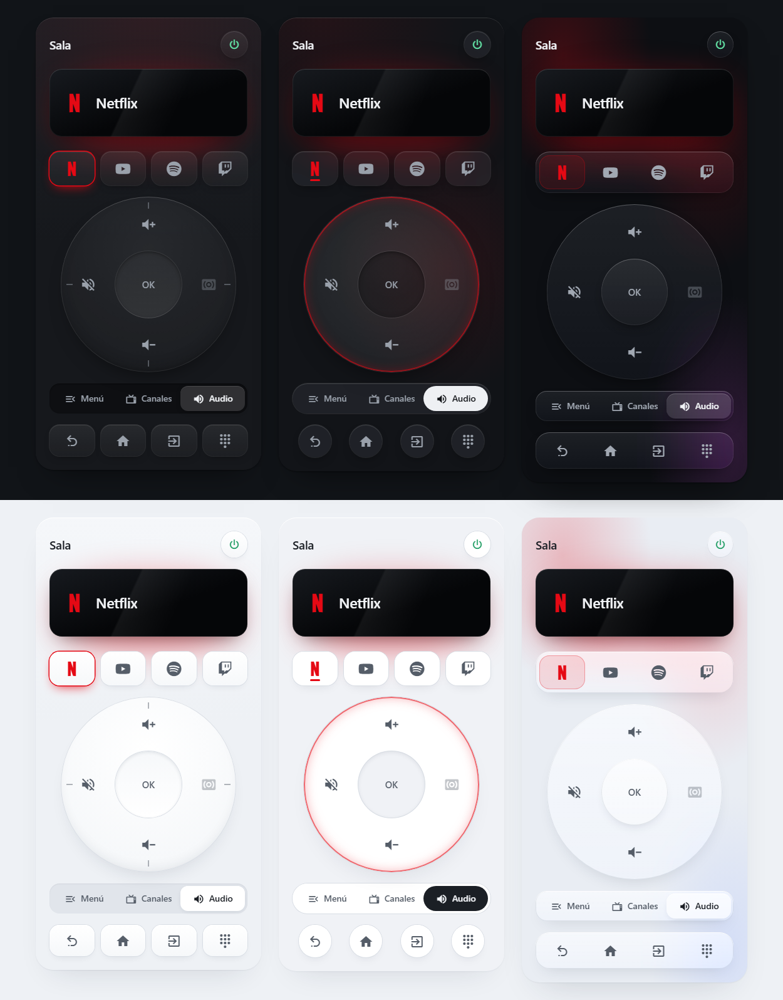
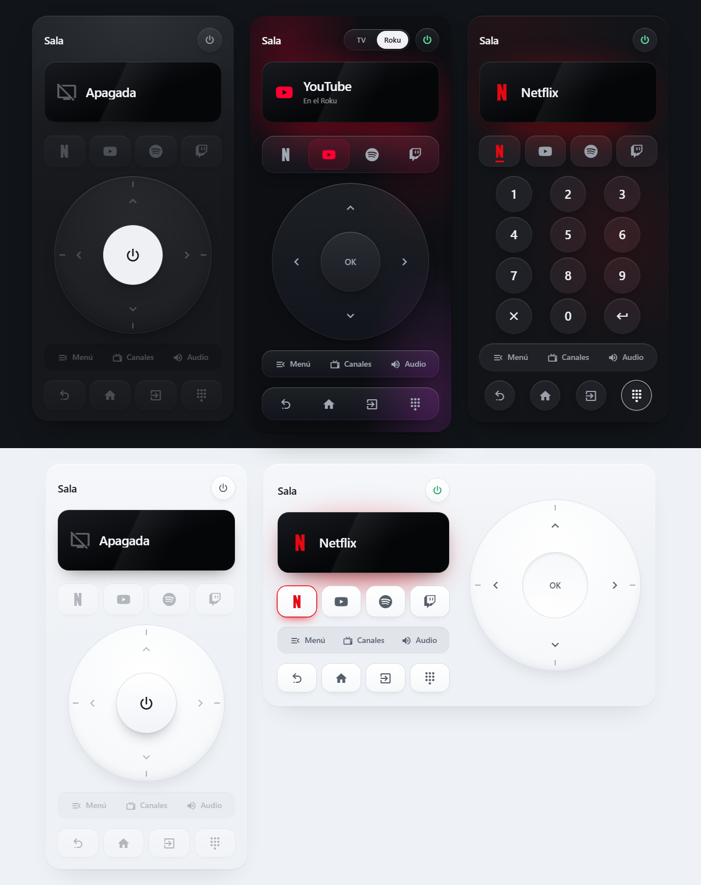

# TV Control Card

🌐 [English version](README.en.md)

Tarjeta de Home Assistant para controlar televisores **LG (webOS)** y **Samsung**, con
soporte opcional para un **Roku** conectado a la TV. Varias TVs en una sola tarjeta,
tres estilos visuales, tema claro u oscuro y un editor visual.

[](CHANGELOG.md)
[](https://github.com/custom-components/hacs)



---

## Características

- **Tres estilos**: `relieve` (predeterminado), `halo` y `cristal`, en tema `dark`,
  `light` o `auto` (sigue el modo oscuro de Home Assistant).
- **Pantalla de estado** con la app o fuente activa, teñida con el color de la marca.
- **Touchpad** con modos (Menú, Canales, Audio y hasta 3 modos personalizados).
- **4 botones de streaming**: si la TV está apagada, la encienden y abren la app.
- **Varias TVs** en una tarjeta, con la TV elegida recordada por usuario.
- **Roku conectado a la TV**: selector TV | Roku y apps que solo existen en el Roku.
- **Configuración por TV**: modos, botones o streaming distintos para una TV concreta.
- **Cualquier acción en cualquier botón**: tecla, fuente, script, servicio, command de
  LG, código crudo, secuencia (p. ej. un PIN), una acción distinta por marca o el
  teclado numérico.
- **Seguro**: mantener presionada una flecha nunca traba la TV, y la tarjeta nunca
  apaga una TV por un estado desactualizado.
- **Responsiva**: se adapta al ancho real de la tarjeta, del celular a la tablet de
  pared (donde pasa a dos columnas).



---

## Requisitos

- Home Assistant con un dashboard de Lovelace.
- Según la marca:
  - **LG**: integración oficial [LG webOS TV](https://www.home-assistant.io/integrations/webostv/).
    Para encender la TV hace falta configurar el encendido (Wake on LAN) en la integración.
  - **Samsung**: integración [SamsungTV Smart](https://github.com/ollo69/ha-samsungtv-smart) (HACS).
  - **Roku** (opcional): integración oficial [Roku](https://www.home-assistant.io/integrations/roku/),
    que crea un `media_player` y un `remote`.
- [Custom Brand Icons](https://github.com/elax46/custom-brand-icons) para los íconos
  `phu:` (Disney+, Prime Video, Apple TV, Max, Roku…).
- Un navegador o app con soporte de container queries y `color-mix()`:
  Chrome/Edge 111+, Safari/iOS 16.4+, o la app de Home Assistant actualizada.

---

## Instalación

### Con HACS (recomendado)

1. HACS → menú de tres puntos → **Custom repositories**.
2. Agrega `https://github.com/extraiotpruebas/minimalist-tv-control-card` con la
   categoría **Dashboard**.
3. Busca **TV Control Card** e instálala.
4. Recarga el navegador (Ctrl + F5).

### Manual

1. Copia `dist/minimalist-tv-control-card.js` (de este repositorio) a `/config/www/`.
2. **Configuración → Dashboards → ⋮ → Recursos → Agregar recurso**:
   - URL: `/local/minimalist-tv-control-card.js?v=1`
   - Tipo: **Módulo JavaScript**
3. Cada vez que reemplaces el archivo, sube el número de `?v=` para que los
   navegadores y la app no usen la copia vieja.

### Probar la v4 junto a la versión que ya tienes instalada

Dos versiones no pueden registrar el mismo nombre de tarjeta. Con `?tag=` la v4 se
registra con otro nombre y conviven:

1. Copia el archivo nuevo con otro nombre, p. ej. `/config/www/tv-card-v4.js`.
2. Agrega el recurso `/local/tv-card-v4.js?tag=tv-control-card-v4&v=1` (Módulo JavaScript).
3. En la tarjeta de prueba usa `type: custom:tv-control-card-v4`.

Las tarjetas existentes (`custom:tv-control-card`) siguen usando la versión instalada.

---

## Configuración

La forma más fácil es el **editor visual** (Editar tarjeta). Muestra solo lo que está
configurado; lo demás aparece como **+ Agregar…** o **Personalizar**. Si la tarjeta
tiene un YAML de una versión anterior, el editor ofrece el botón **Convertir a formato
v4**.

### Mínima

```yaml
type: custom:tv-control-card
tvs:
  - name: Sala
    entity: media_player.tv_sala
    platform: lg            # lg | samsung
```

### Completa (ejemplo)

```yaml
type: custom:tv-control-card
card_id: sala               # recuerda la TV elegida por usuario (único por tarjeta)
style: halo                 # relieve | halo | cristal
theme: auto                 # dark | light | auto
control_mode_entity: input_select.modo_tv   # opcional

tvs:
  - name: Sala
    entity: media_player.tv_sala
    platform: lg
    companion:                              # Roku conectado a esta TV (opcional)
      media_entity: media_player.roku_sala
      remote_entity: remote.roku_sala
  - name: Recámara
    entity: media_player.tv_recamara
    platform: samsung
    overrides:                              # configuración propia de esta TV (opcional)
      modes: [audio, menu, busqueda]
      buttons:                              # reemplaza a `buttons` global completo
        menu: { icon: mdi:dialpad, action: numpad }
        top_left: { icon: mdi:palette, action: script.modo_arte }

modes: [menu, busqueda, custom1]            # los 3 modos de la fila

custom_modes:
  custom1:
    label: Amplificador
    icon: mdi:speaker
    up:    { icon: mdi:volume-plus,  action: script.ampli_subir }
    down:  { icon: mdi:volume-minus, action: script.ampli_bajar }
    left:  { icon: mdi:volume-off,   action: mute }
    right: { icon: mdi:power,        action: script.ampli_power }

streaming:                                  # los 4 botones, en orden
  - source: netflix
  - source: disney
  - source: YouTube
  - source: hdmi2
    icon: mdi:sony-playstation
    accent: '#0070d1'

buttons:
  menu: { icon: mdi:dialpad, action: numpad }   # el botón Menú abre el teclado numérico
```

---

## Referencia

### Opciones generales

| Opción | Default | Descripción |
|---|---|---|
| `tvs` | — (**requerida**) | Lista de TVs. Ver abajo. |
| `card_id` | derivado de las entidades | Identifica la tarjeta para recordar la TV elegida por cada usuario. Úsalo si tienes varias tarjetas con las mismas TVs. |
| `style` | `relieve` | `relieve`, `halo` o `cristal`. |
| `theme` | `dark` | `dark`, `light` o `auto`. |
| `control_mode_entity` | — | `input_select` que fija el modo activo. Sus opciones deben ser ids de modo (`menu`, `audio`, `custom1`…); cualquier otro valor deja el touchpad sin modo. |
| `modes` | `[menu, busqueda, audio]` | Los 3 modos de la fila. |
| `custom_modes` | — | Definición de `custom1`, `custom2`, `custom3`. |
| `default_pad` | flechas | El touchpad cuando no hay modo activo. |
| `streaming` | Netflix, Disney+, YouTube, Apple TV | Los 4 botones de streaming. |
| `buttons` | — | Cambia ícono o acción de los botones fijos. |

### `tvs`

| Opción | Descripción |
|---|---|
| `name` | Nombre que se muestra. |
| `entity` | `media_player` de la TV (**requerida**). |
| `platform` | `lg` o `samsung` (default `lg`). |
| `companion` | Roku conectado: `media_entity` (`media_player`) y `remote_entity` (`remote`). |
| `overrides` | Configuración propia de esta TV. Acepta `modes`, `custom_modes`, `default_pad`, `streaming` y `buttons`. Cada categoría que pongas **reemplaza completa** a la global (no se mezcla campo por campo). |

Con dos o más TVs, tocar el nombre de la TV abre el selector.

### Modos

Tocar un modo lo activa; tocarlo otra vez vuelve al touchpad sin modo (`default_pad`).

| Id | Nombre | ↑ | ← | → | ↓ |
|---|---|---|---|---|---|
| `menu` | Menú | Inicio | Menú | Salir | Atrás |
| `busqueda` | Canales | Canal + | Menú de fuentes | Guía | Canal − |
| `audio` | Audio | Volumen + | Silenciar | — | Volumen − |
| `fuentes` *(experimental)* | Fuentes | HDMI 1 | HDMI 2 | HDMI 3 | HDMI 4 |
| `info` *(experimental)* | Información | Guía | Info | Mis apps | Herramientas |
| `custom1`…`custom3` | Personalizado | definidos en `custom_modes` |

`navegacion` (de versiones anteriores) se convierte en `menu`. En los modos `audio` y
`fuentes` todo va a la TV aunque el modo Roku esté activo.

### `custom_modes` y `default_pad`

```yaml
custom_modes:
  custom2:
    label: PIN
    icon: mdi:lock
    up:    { icon: mdi:lock-open, action: [digit_1, digit_2, digit_3, digit_4, enter] }
    left:  { icon: mdi:television-guide, action: guide }
    right: info                     # atajo: solo la acción (queda sin ícono)
    down:  { icon: mdi:cast }       # sin action: el botón queda vacío

default_pad:
  up: { icon: mdi:chevron-up, action: up }
```

Cada dirección (`up`, `left`, `right`, `down`) lleva `icon` y `action`.

### `streaming`

Siempre son 4 botones. Cada uno:

| Campo | Descripción |
|---|---|
| `source` | Id del catálogo (tabla de abajo). |
| `icon` | Cambia el ícono. |
| `accent` | Color del botón activo y de la pantalla (`'#e50914'` o `'229, 9, 20'`). |
| `action` | Acción propia en lugar de abrir la fuente. |

Al tocarlo: si la TV está apagada la enciende; luego abre la fuente y espera la
confirmación (reintenta una vez). Con Roku en modo Roku, o si la app solo existe en el
Roku (p. ej. Fubo), la abre en el Roku.

<details>
<summary>Catálogo de fuentes</summary>

| `source` | Nombre | Ícono | En la TV (`select_source`) | En el Roku |
|---|---|---|---|---|
| `netflix` | Netflix | `mdi:netflix` | `Netflix` | `Netflix` |
| `disney` | Disney+ | `phu:disney-plus` | `Disney+` | `Disney Plus` |
| `prime` | Prime Video | `phu:prime-video` | `Prime Video` | `Prime Video` |
| `YouTube` | YouTube | `mdi:youtube` | `YouTube` | `YouTube` |
| `appletv` | Apple TV | `phu:apple-tv` | `Apple TV` | `Apple TV` |
| `hbomax` | Max | `phu:hbo-max` | `Max` | `Max` |
| `paramount` | Paramount+ | `phu:paramount-plus` | `Paramount+` | `Paramount Plus` |
| `dazn` | DAZN | `phu:dazn` | `DAZN` | `DAZN Live Sports Streaming` |
| `universal` | Universal+ | `mdi:earth` | `Universal+` | `Universal+` |
| `spotify` | Spotify | `mdi:spotify` | `Spotify` | `Spotify` |
| `crunchyroll` | Crunchyroll | `mdi:alpha-c-circle` | `Crunchyroll` | `Crunchyroll` |
| `twitch` | Twitch | `mdi:twitch` | `Twitch` | `Twitch` |
| `fubo` | Fubo | `mdi:alpha-f-circle` | solo por Roku | `Fubo: Watch Live TV & Sports` |
| `roku` | Roku | `phu:roku-ultra` | `Roku OTT` o `Roku` | — |
| `hdmi1` … `hdmi4` | HDMI 1 … 4 | `mdi:hdmi-port` | `HDMI 1` … `HDMI 4` | — |

El nombre se busca sin distinguir mayúsculas en la lista de fuentes que reporta la TV
(`source_list`).

</details>

### `buttons`

| Botón | Default | Notas |
|---|---|---|
| `top_left` | oculto | Botón del encabezado, a la izquierda. Solo aparece si le asignas una acción propia (p. ej. un script). Con Roku, su lugar lo ocupa el selector TV \| Roku. |
| `power` | encender / apagar | Con una acción propia, esa acción reemplaza al encendido y al apagado. |
| `center` | `enter` (OK) | Con la TV apagada, el centro es el botón **Encender** (solo enciende, nunca apaga). |
| `back` | `back` | Fila de abajo. |
| `home` | `home` | Fila de abajo. |
| `exit` | `exit` | Fila de abajo. |
| `menu` | `menu` | Fila de abajo. |

Cada botón acepta `icon` y `action`. Atajo: `power: script.x` equivale a
`power: { action: script.x }`.

**Con la TV apagada** el touchpad, los modos y la fila de abajo quedan bloqueados.
Siguen activos el centro (Encender), el power, los botones de streaming y `top_left`.

### Acciones

Cualquier `action` puede escribirse así:

```yaml
action: vol_up                      # tecla (tabla de abajo); también VOLUMEUP o KEY_VOLUP
action: script.mi_script            # script o escena
action: numpad                      # abre el teclado numérico
action: [digit_1, digit_2, enter]   # secuencia (pausa de 400 ms)

action: { type: key, key: input_menu }
action: { type: button, button: KEY_HDMI }            # código crudo de la marca
action: { type: source, source: HDMI 2 }              # select_source
action: { type: service, service: light.toggle, data: { entity_id: light.sala } }
action:                                               # command de LG (webostv.command)
  type: command
  command: system.launcher/launch
  payload: { id: netflix }
action:                                               # secuencia con pausa propia
  type: sequence
  delay: 600
  steps: [home, down, down, enter]
action:                                               # una acción por marca
  type: platform
  by:
    lg: { type: command, command: tv/switchInput, payload: { inputId: HDMI_1 } }
    samsung: { type: button, button: KEY_HDMI1 }
    default: input_menu
```

- **Mantener presionado** repite solo las flechas (cada 250 ms, hasta 10 s). Todo lo
  demás se manda una vez por toque.
- **Con Roku en modo Roku** van al Roku solo las teclas que el Roku tiene (menos
  volumen y silencio) y las acciones `platform` con variante `roku`. Todo lo demás va a
  la TV: EXIT siempre funciona.
- **Commands de LG útiles**: `system.launcher/launch` (`{id}`), `tv/switchInput`
  (`{inputId: HDMI_1}`), `com.webos.service.tvpower/power/turnOffScreen` (apaga solo
  la pantalla), `system.notifications/createToast` (`{message}`),
  `com.webos.service.ime/insertText` (`{text, replace: 0}`), `media.controls/play`.
  Los ids de apps y entradas aparecen en **Dispositivos → (la TV) → Descargar
  diagnósticos**.

<details>
<summary>Tabla de teclas</summary>

| Tecla | Qué hace | LG | Samsung | Roku |
|---|---|---|---|---|
| `up` | Arriba | `UP` | `KEY_UP` | `up` |
| `down` | Abajo | `DOWN` | `KEY_DOWN` | `down` |
| `left` | Izquierda | `LEFT` | `KEY_LEFT` | `left` |
| `right` | Derecha | `RIGHT` | `KEY_RIGHT` | `right` |
| `enter` | Enter / OK | `ENTER` | `KEY_ENTER` | `select` |
| `back` | Atrás | `BACK` | `KEY_RETURN` | `back` |
| `exit` | Salir | `EXIT` | `KEY_EXIT` | — |
| `home` | Inicio | `HOME` | `KEY_HOME` | `home` |
| `menu` | Menú | `MENU` | `KEY_MENU` | — |
| `info` | Info | `INFO` | `KEY_INFO` | `info` |
| `guide` | Guía | `GUIDE` | `KEY_GUIDE` | — |
| `apps` | Mis apps | `MYAPPS` | `KEY_APP_LIST` | — |
| `search` | Buscar | — | — | `search` |
| `input_menu` | Menú de fuentes | `INPUT_HUB` | `KEY_SOURCE` | — |
| `ch_up` | Subir canal | `CHANNELUP` | `KEY_CHUP` | `channel_up` |
| `ch_down` | Bajar canal | `CHANNELDOWN` | `KEY_CHDOWN` | `channel_down` |
| `ch_prev` | Canal anterior | — | `KEY_PRECH` | — |
| `vol_up` | Subir volumen | `VOLUMEUP` | `KEY_VOLUP` | `volume_up` |
| `vol_down` | Bajar volumen | `VOLUMEDOWN` | `KEY_VOLDOWN` | `volume_down` |
| `mute` | Silenciar | `MUTE` | `KEY_MUTE` | `volume_mute` |
| `play` | Play | `PLAY` | `KEY_PLAY` | `play` |
| `pause` | Pausa | `PAUSE` | `KEY_PAUSE` | `play` |
| `stop` | Stop | `STOP` | `KEY_STOP` | — |
| `rewind` | Rebobinar | `REWIND` | `KEY_REWIND` | `reverse` |
| `ff` | Avance rápido | `FASTFORWARD` | `KEY_FF` | `forward` |
| `replay` | Repetir | — | — | `replay` |
| `record` | Grabar | `RECORD` | `KEY_REC` | — |
| `cc` | Subtítulos | `CC` | `KEY_CAPTION` | — |
| `asterisk` | Asterisco / Herramientas | `ASTERISK` | `KEY_TOOLS` | — |
| `screen_remote` | Control en pantalla | `SCREEN_REMOTE` | — | — |
| `red` | Rojo | `RED` | `KEY_RED` | — |
| `green` | Verde | `GREEN` | `KEY_GREEN` | — |
| `yellow` | Amarillo | `YELLOW` | `KEY_YELLOW` | — |
| `blue` | Azul | `BLUE` | `KEY_CYAN` | — |
| `digit_0` … `digit_9` | Dígitos | `0`…`9` | `KEY_0`…`KEY_9` | — |

Una tecla que la marca no tiene (—) muestra un aviso en lugar de mandar algo.

</details>

---

## Actualizar desde la versión 3

Los YAML de la versión 3 **siguen funcionando** sin cambios: la tarjeta los traduce al
cargarlos. Para pasarlos al formato nuevo, abre el editor visual y toca **Convertir a
formato v4**; el resultado se comporta igual.

| v3 | v4 |
|---|---|
| `entity` + `modelConfig` | `tvs: [{ entity, platform }]` |
| `colorMode` | `theme` |
| `mode_slot_1..3` | `modes: [ … ]` |
| `navegacion` | `menu` |
| `custom1_up_icon`, `custom1_up_value(_lg/_samsung)` | `custom_modes.custom1.up: { icon, action }` |
| `netflix_icon`, `netflix_value`, `appletv_source`… | `streaming: [ { source, icon, action, accent } ]` |
| `exit_icon` / `exit_value` (botón de arriba) | `buttons.top_left` |
| `back_type: numpad` | `buttons.back.action: numpad` |
| `roku: { … }` dentro de la TV | `companion: { media_entity, remote_entity }` |
| `script.x`, `source:HDMI 1`, `command:…` | se siguen aceptando como acciones |

Cambios de comportamiento:

- El botón **Salir** de abajo ahora sí manda EXIT; el de arriba es `top_left`.
- Los modos `text` y `amplificador` se omiten (volverán en una versión futura).
- La clave `selected_sources` ya no se usa.

La lista completa está en el [CHANGELOG](CHANGELOG.md).

---

## Solución de problemas

**La tarjeta no aparece o sale "Custom element doesn't exist"**
Revisa que el recurso esté agregado como *Módulo JavaScript* y recarga con Ctrl + F5.
En la app, cierra y vuelve a abrir (o sube el `?v=` del recurso).

**Tarjeta roja con un mensaje** — el YAML tiene un error que impide usarla (p. ej.
una TV sin `entity`). El mensaje dice cuál.

**Algo del YAML no hace efecto** — abre la consola del navegador (F12): la tarjeta
avisa ahí de las claves que no entiende (`[tv-control-card] …`).

**La LG no enciende** — configura el encendido (Wake on LAN) en la integración webOS.
La tarjeta avisa si la TV no confirma el encendido en 20 s.

**"No se pudo confirmar el cambio a …"** — la TV no reportó la fuente pedida. Revisa
que el nombre exista en el atributo `source_list` de la entidad.

**Los íconos de Disney+, Prime Video, etc. no aparecen** — instala Custom Brand Icons.

---

## Desarrollo

Ver [docs/ARCHITECTURE.md](docs/ARCHITECTURE.md) (cómo está hecha y cómo extenderla) y
[docs/GUIA-DE-ESTUDIO.md](docs/GUIA-DE-ESTUDIO.md) (el código explicado desde cero).

El código fuente está en `src/` (módulos ES, render con [Lit](https://lit.dev)).
[Vite](https://vite.dev) los junta en un solo archivo, `dist/minimalist-tv-control-card.js`,
que es el que se instala en HA y ya incluye Lit. Requiere Node 22.

```bash
npm install          # una vez: instala Lit y Vite
npm run dev          # http://localhost:5173/dev/harness.html, recarga al guardar
npm test             # pruebas de Node (incluye comparar dist/ con src/)
npm run build        # genera dist/minimalist-tv-control-card.js
```

- `dev/harness.html`: tarjeta y editor con un HA simulado.
- `dev/selftest.html`: autoprueba en el navegador. Con `?build=dist` prueba el
  archivo final en lugar de `src/`.

Las páginas de `dev/` necesitan el servidor de Vite (`npm run dev`) para cargar
`src/`; con `?build=dist` funcionan con cualquier servidor.

Después de cambiar `src/`, corre `npm run build` e incluye `dist/` en el commit:
HACS descarga ese archivo tal como está en el repositorio (la GitHub Action avisa si
quedó desactualizado).

---

## Licencia

MIT — ver [LICENSE](LICENSE).

> Tarjeta no oficial, sin relación con LG Electronics, Samsung Electronics ni Roku.
