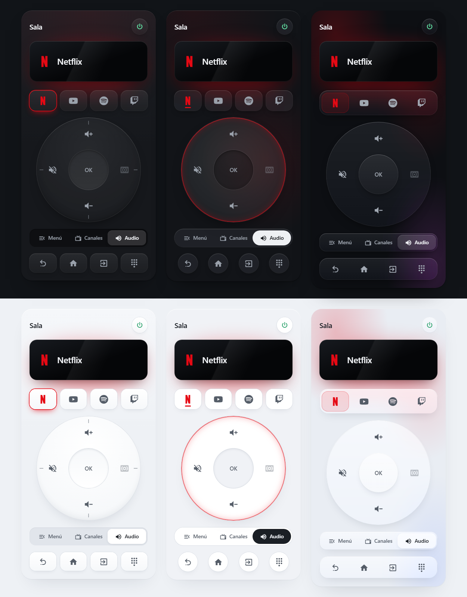

# TV Control Card

Tarjeta para controlar televisores **LG (webOS)** y **Samsung** desde Home Assistant,
con soporte opcional para un **Roku** conectado a la TV.



- Tres estilos (`relieve`, `halo`, `cristal`) y tema claro, oscuro o automático.
- Varias TVs en una tarjeta, con la TV elegida recordada por usuario.
- Touchpad con modos, 4 botones de streaming y botones configurables.
- Cualquier acción en cualquier botón: tecla, fuente, script, servicio, command de LG,
  secuencia o teclado numérico.
- Mantener presionado nunca traba la TV y la tarjeta nunca la apaga por un estado viejo.
- Editor visual incluido.

## Inicio rápido

```yaml
type: custom:tv-control-card
tvs:
  - name: Sala
    entity: media_player.tv_sala
    platform: lg        # lg | samsung
```

Documentación completa en el [repositorio](https://github.com/extraiotpruebas/minimalist-tv-control-card).
